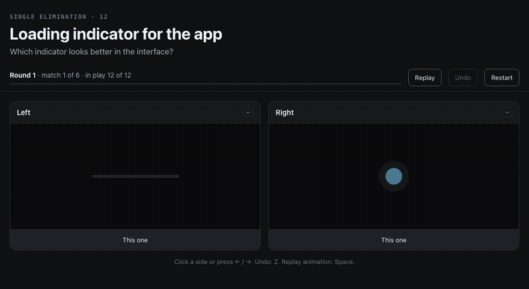
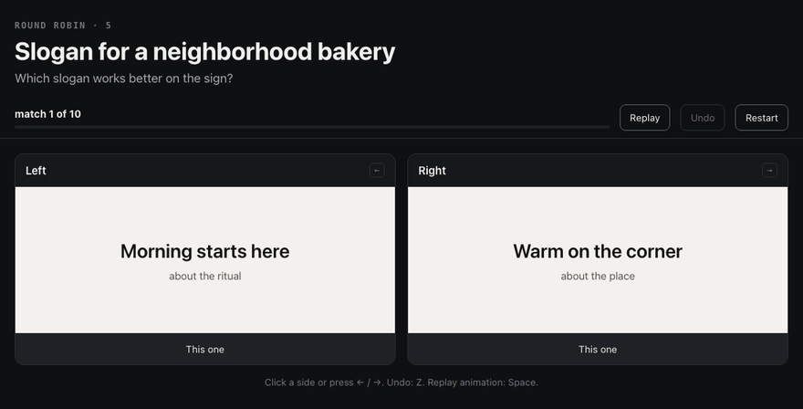
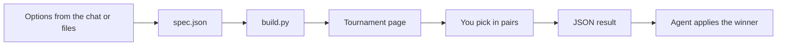

# tournament

A skill for Claude Code, Codex and other agents that read `SKILL.md`: a pairwise tournament of options. When there are many options and you cannot pick one, the agent builds a one-off page. It shows two options side by side, you pick the better one with a click or an arrow key, and so on until a winner emerges. At the end you get a final ranking and a JSON result the agent applies on its own.

[Русская версия](README.md)



## Why

Picking one of twelve options by eye does not work: all of them on one screen blur together, attention sticks to the first and the last, and it is hard to say in words why one is better. Picking one of two is easy. A tournament turns one big choice into a chain of small ones: eleven duels instead of a single decision among twelve.

The skill makes this take a minute instead of an evening: the agent turns the options into a page, the page runs the bracket, and the result comes back to the agent in a form it can act on right away.

## Features

- **Two formats.** Single elimination: `n - 1` duels, up to 64 options. Round robin: `n(n-1)/2` duels, up to 10 options, full ranking.
- **Anything that can be shown:** text with a caption, image, HTML and CSS, code snippet.
- **Blind.** A duel shows "Left" and "Right"; names appear only in the results.
- **Fair animations.** Every option renders in its own shadow DOM: candidate CSS cannot break the page or the neighbor. Animations in a pair start together, Space restarts both.
- **Keyboard:** ← / → pick, Z undo, Space replay the animation.
- **Resume.** Progress is stored in the browser; the page can be closed.
- **Result for the agent:** winner, runner-up, ranking, all matches, a "why" field and the task from the spec.
- **No dependencies.** One HTML page that works from a file; the builder uses only the Python standard library.



## How it works



1. The agent collects the options and writes `spec.json` (format: [`references/spec.md`](skills/tournament-en/references/spec.md)).
2. `python3 scripts/build.py spec.json --open` validates the spec, embeds images and opens the page.
3. You go through the duels and press "Copy result".
4. You paste the JSON into the chat, and the agent does what the `task` field says.

Minimal spec:

```json
{
  "title": "Name for a plant-watering reminder app",
  "question": "Which name is easier to remember?",
  "lang": "en",
  "items": [
    { "text": "Sprout" }, { "text": "Droplet" }, { "text": "Leafy" },
    { "text": "Windowsill" }, { "text": "Jungle" }, { "text": "Thirsty" }
  ]
}
```

## Install

### Claude Code: plugin marketplace

```
/plugin marketplace add vasilievyakov/tournament-skill
/plugin install tournament-en@tournament-skill
```

### Claude Code, Codex, Cursor and other agents: skills CLI

```bash
npx skills add https://github.com/vasilievyakov/tournament-skill --skill tournament-en
```

The Russian version of the skill is `--skill tournament`.

### Manually

```bash
git clone https://github.com/vasilievyakov/tournament-skill
ln -s "$PWD/tournament-skill/skills/tournament-en" ~/.claude/skills/tournament-en   # Claude Code
ln -s "$PWD/tournament-skill/skills/tournament-en" ~/.agents/skills/tournament-en   # Codex and others
```

Requires Python 3.8+. The self-test needs Google Chrome or Chromium.

## How to call it

Tell the agent "let's run a tournament", "pairwise", "I can't choose between these" or call `/tournament`. The skill also triggers on its own when there are more than five options and you hesitate.

## Layout

```
skills/
  tournament/          Russian version: SKILL.md, references/spec.md
    scripts/build.py   builds the page from a spec
    assets/template.html  the tournament page
    tests/selftest.py  plays a tournament in headless Chrome and checks the result
  tournament-en/       English version; scripts, assets and tests are shared
demo/                  the demo tournaments behind the GIFs and the run recorder
tools/sync_en.py       syncs the shared files into the English version
```

## Development

```bash
python3 skills/tournament-en/tests/selftest.py demo/en/*.json
python3 tools/sync_en.py && python3 tools/sync_en.py --check
node demo/record.mjs <page.html> <frames dir>     # record a demo run for a GIF
```

Edit the template and the script in `skills/tournament`, then `tools/sync_en.py` copies them into the English version.

## License

MIT
