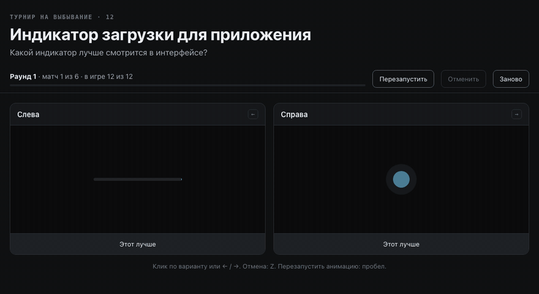
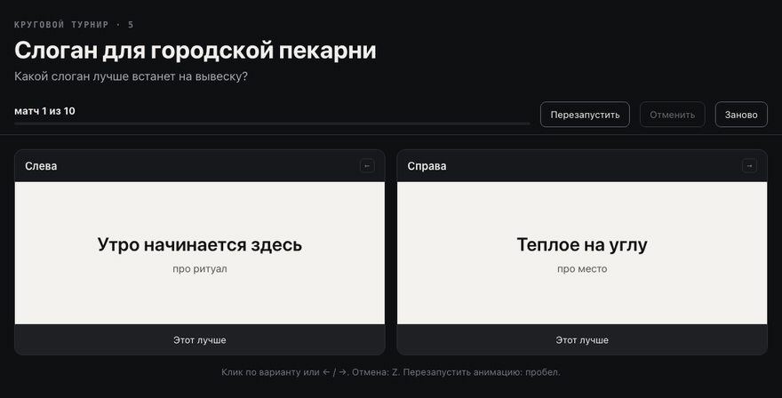
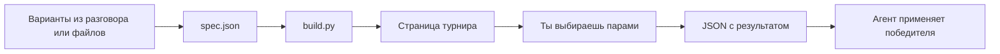

# tournament

Скилл для Claude Code, Codex и других агентов, которые читают `SKILL.md`: турнир вариантов парами. Когда вариантов много и выбрать сразу не получается, агент собирает одноразовую страницу. На ней два варианта рядом, ты выбираешь лучший кликом или стрелкой, и так до победителя. В конце итоговые места и JSON, который агент применяет сам.

[English version](README.en.md)



## Ради чего

Из двенадцати вариантов глазами не выбирается: все одновременно на экране сливаются, внимание цепляется за первые и последние, а словами объяснить, чем один лучше другого, трудно. Из двух выбирается легко. Турнир сводит большой выбор к цепочке маленьких: одиннадцать дуэлей вместо одного решения из двенадцати.

Скилл нужен, чтобы этот прием занимал минуту, а не вечер: агент сам собирает варианты в страницу, страница сама ведет сетку, а результат возвращается агенту в виде, с которым он сразу работает.

## Что умеет

- **Два формата.** На выбывание: `n - 1` дуэлей, до 64 вариантов. Каждый с каждым: `n(n-1)/2` дуэлей, до 10 вариантов, полная таблица мест.
- **Любые варианты, которые можно показать:** текст с подписью, картинка, HTML и CSS, фрагмент кода.
- **Вслепую.** В дуэли видно «Слева» и «Справа», названия открываются только в итогах.
- **Честные анимации.** Каждый вариант рисуется в своем shadow DOM: CSS кандидатов не ломает страницу и не задевает соседа. Анимации в паре стартуют одновременно, пробел перезапускает обе.
- **Клавиатура:** ← / → выбрать, Z отменить, пробел перезапустить анимацию.
- **Продолжение с места остановки.** Прогресс хранится в браузере, страницу можно закрыть.
- **Результат для агента:** победитель, финалист, места, все матчи, поле «почему» и задача из spec.
- **Без зависимостей.** Одна HTML-страница, работает из файла; сборщик на стандартной библиотеке Python.



## Как это работает



1. Агент собирает варианты и пишет `spec.json` (формат: [`references/spec.md`](skills/tournament/references/spec.md)).
2. `python3 scripts/build.py spec.json --open` проверяет spec, вшивает картинки и открывает страницу.
3. Ты проходишь дуэли и жмешь «Скопировать результат».
4. Вставляешь JSON в чат, агент делает то, что записано в `task`.

Минимальный spec:

```json
{
  "title": "Название для приложения-напоминалки",
  "question": "Какое название лучше запоминается?",
  "items": [
    { "text": "Полив" }, { "text": "Зеленка" }, { "text": "Листик" },
    { "text": "Капля" }, { "text": "Подоконник" }, { "text": "Джунгли" }
  ]
}
```

## Установка

### Claude Code: через маркетплейс плагинов

```
/plugin marketplace add vasilievyakov/tournament-skill
/plugin install tournament@tournament-skill
```

### Claude Code, Codex, Cursor и другие агенты: через skills CLI

```bash
npx skills add https://github.com/vasilievyakov/tournament-skill --skill tournament
```

Английская версия скилла: `--skill tournament-en`.

### Вручную

```bash
git clone https://github.com/vasilievyakov/tournament-skill
ln -s "$PWD/tournament-skill/skills/tournament" ~/.claude/skills/tournament   # Claude Code
ln -s "$PWD/tournament-skill/skills/tournament" ~/.agents/skills/tournament   # Codex и другие
```

Нужен Python 3.8+. Для самопроверки нужен Google Chrome или Chromium.

## Как вызвать

Скажи агенту «устроим турнир», «давай парами», «не могу выбрать из этих вариантов» или вызови `/tournament`. Скилл срабатывает и сам, когда на выбор больше пяти вариантов и ты колеблешься.

## Состав

```
skills/
  tournament/          русская версия: SKILL.md, references/spec.md
    scripts/build.py   сборщик страницы из spec
    assets/template.html  страница турнира
    tests/selftest.py  проигрывает турнир в headless Chrome и проверяет результат
  tournament-en/       английская версия; scripts, assets, tests общие
demo/                  два демо-турнира, на которых сняты гифки, и запись прогона
tools/sync_en.py       синхронизирует общие файлы английской версии
```

## Разработка

```bash
python3 skills/tournament/tests/selftest.py        # прогон обоих демо
python3 tools/sync_en.py && python3 tools/sync_en.py --check
node demo/record.mjs <page.html> <папка кадров>    # запись демо для гифки
```

Правки шаблона и скрипта делаются в `skills/tournament`, затем `tools/sync_en.py` копирует их в английскую версию.

## Лицензия

MIT
